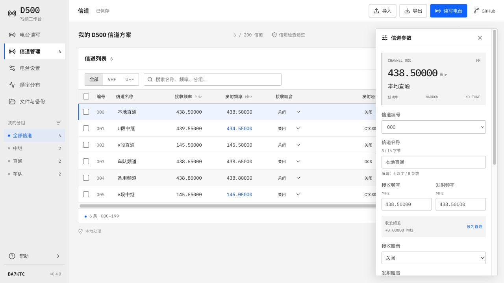

# Radio Workbench

网页电台写频工作台。支持即时通 D500、宝锋 UV-5R / UV-5RH 普通版、泉盛 UV-K5 / K6（原厂、LOSEHU、Egzumer）。

[](LICENSE)

D500 面向**无航空接收的旧版**。所有型号均在网页中直接连接写频线，文件、驱动与串口数据在浏览器本地处理，不需要账号、本机连接器或额外安装写频软件。本仓库提供代码与自行部署说明。

> ⚠️ **刷写有风险，请先备份电台原始配置。** 使用本软件造成的数据丢失、设备损坏等后果由使用者自行承担，作者不承担责任。



## 功能

- **信道编辑**：000–199 编号、搜索与分组、批量修改、复制、移动、撤销和频率分布。
- **收发参数**：频率、功率、带宽、扫描及独立的 CTCSS / DCS，支持预设、手动值和数字码极性。
- **设备设置**：42 项整机菜单、A/B 频率模式、可展开的 C/D 数据及开机文字。
- **文件处理**：导入 DAT、XLSX、CSV、TSV 和完整方案；导出 DAT 或包含分组、备注的完整方案。
- **直接读写**：连接、读取备份、默认仅写修改、可选完整覆盖；显示修改明细、块数和预计用时。
- **本地保存**：草稿与上次读写状态在本浏览器保存，刷新后可继续编辑。

## 多型号支持

所有型号使用统一导航，支持分组、批量编辑、复制移动、撤销重做和频率分布。左侧选择型号与固件，各型号保存独立方案。

**共享信道库**用于跨型号维护同一批信道。选择信道加入库，再应用到目标机型；默认更新已关联的位置，其余追加到空位，也可按编号合并或替换全部信道。名称默认优先使用符合机型限制的完整原名，超出限制时使用已存别名；也可选择机型别名或逐条修改。应用前显示名称、频段、功率和容量适配结果。

手台信道可先编辑、导入表格，之后读取或导入该机 IMG 作为整机配置；载入配置时保留已有信道编辑。跨型号只迁移公共信道字段，整机设置和专属参数保留目标机型的数据。共享库可导出 `.channels.json`，各机型完整 JSON 另存分组与关联；不将不同型号的镜像互刷。

- **UV-5R**：128 信道及对应驱动配置。
- **UV-5RH 普通版**：1000 信道、多频段、12 字节 GBK 中文名称及对应驱动配置。
- **UV-K5 / K6**：原厂、Egzumer、LOSEHU 使用不同驱动；LOSEHU 按实际固件自动适配非扩容版、扩容版和不同年代的名称字库，开放已核对的基本设置。
- **文件**：CHIRP IMG、完整 JSON、表格导入和 D500 方案信道迁移；IMG 在网页内验证与编码。

普通 UV-5RH 已完成实机中文名称写读、完整配置恢复及 Chrome 网页实机读取；LOSEHU 非扩容 132 已实机读取并通过 101 条信道零差异重编码；其他新增型号和固件分支通过参考镜像与软件验证，尚待逐台实测。不能将此视作全部固件、全部设置都兼容。LOSEHU 扩容菜单、侧键及信令等未映射字段保留原数据，详细边界见[驱动说明](radio-core/README.md)，各型号独立项目核对见[研究记录](docs/MODEL_RESEARCH.md)。

## 本地运行

需要 Node.js 22.12 或更高版本、npm，以及桌面 Chrome / Edge。

```sh
git clone https://github.com/JukZeon/d500-web.git
cd d500-web
npm ci
npm run dev
```

打开终端显示的本地地址。纯文件编辑无需电台；直接读写需要兼容的写频线。远程部署使用 HTTPS，参见[部署指南](docs/DEPLOYMENT.md)。

## D500 使用

1. 导入原厂 DAT、完整方案，或读取电台。只有表格时，还需载入 DAT 模板以保留其他配置。
2. 编辑信道或设备设置。发射频率留空表示仅接收；分组和备注保存在完整方案中。
3. 日常修改使用“仅修改”。已知块与上次读写状态比较，其余块与载入文件比较。
4. 首次把一份文件应用到另一台电台，选择“完整写入”；“仅信道”保留该电台的整机设置，“信道与设置”同时覆盖网页支持的设置块。

完整信道写入覆盖全部 200 个槽位，文件中的空槽位也会清空对应信道。每块收到电台确认后继续，写入结束不自动回读；需要核对时手动读取。更换电台或使用其他软件写入后，可清除上次状态。

### 文件选择

| 格式 | 用途 |
| --- | --- |
| `.dat` | 电台信道与配置，保留模板中的未编辑数据 |
| `.d500.json` | 完整工作方案，另含分组和备注，适合备份与分享 |
| `.xlsx` / `.csv` / `.tsv` | 导入信道；未提供的字段可沿用现有同编号信道 |

名称最多 16 个 GBK 字节。已测试设备屏幕完整显示 6 个汉字或 8 个英数字；更长汉字显示「.」，中英混排的完整显示宽度尚未独立验证。

## 兼容与验证

已在一台旧版无航空接收 D500 上完成浏览器读取、单块增量写入及 400 块整表信道写入。单块名称写入约 4.8 秒；实测范围和审计摘要见[验证记录](docs/VALIDATION.md)。ACK 确认接收与回读一致是不同的验证结果，文档分别记录。

当前不支持航空版适配、固件升级、校准或独立信令码组编辑。完整设置修改、原厂交叉核验及物理断电持久化尚未全面验证；未确认字段保留原值。

## 开发与贡献

```sh
npm run typecheck -- --noUnusedLocals
npm test
npm run build
```

React、TypeScript、Vite；SheetJS CE 固定随仓库提供。测试使用合成数据，不依赖维护者的个人 DAT、表格或电台。提交前运行以上类型检查、测试与生产构建。

- [贡献指南](CONTRIBUTING.md) · [报告问题](https://github.com/JukZeon/d500-web/issues/new/choose)
- [版本记录](CHANGELOG.md) · [发布版本](https://github.com/JukZeon/d500-web/releases)
- [DAT 格式](docs/DAT_FORMAT.md) · [串口协议](docs/SERIAL_PROTOCOL.md) · [部署指南](docs/DEPLOYMENT.md)

## 许可

Copyright © 2026 BA7KTC / JukZeon。项目按 [GNU GPL v3.0](LICENSE) 发布，第三方来源与署名见 [THIRD_PARTY.md](THIRD_PARTY.md)。
